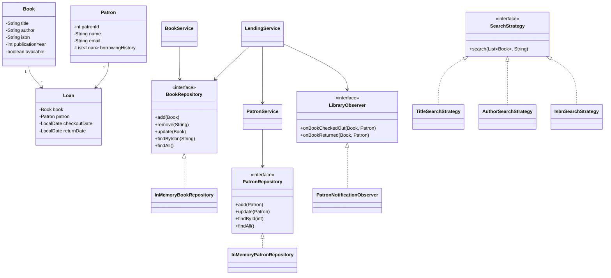

# Library Management System

A Java 17 console-based Library Management System demonstrating Object-Oriented Programming, SOLID principles, Java Collections, design patterns, exception handling, and logging.

The application provides an interactive menu so users can manage books and patrons and perform lending operations directly from the command line.

## Features

### Book Management
- Add books
- Remove books by ISBN
- Update book details
- List all books
- Search by title, author, or ISBN
- Track book availability

### Patron Management
- Add patrons
- Update patron information
- List all patrons
- Track patron borrowing history

### Lending
- Checkout available books
- Return borrowed books
- Prevent checkout of unavailable books
- Prevent invalid returns
- Log important lending events

## Interactive Console Application

The application is fully interactive. Run `Main.java` and choose an operation from the menu.

```text
============================================
       LIBRARY MANAGEMENT SYSTEM
============================================
Welcome! Please choose an option from the menu.

---------------- MAIN MENU ----------------
BOOK MANAGEMENT
  1. Add book
  2. Update book
  3. Remove book
  4. List all books
  5. Search books

PATRON MANAGEMENT
  6. Add patron
  7. Update patron
  8. List all patrons

LENDING
  9. Checkout book
 10. Return book
 11. View borrowing history

  0. Exit
--------------------------------------------
Enter your choice:
```

### Example: Add a Book

Select option `1` and enter the requested information:

```text
--- Add Book ---
Title: Clean Code
Author: Robert C. Martin
ISBN: 9780132350884
Publication year: 2008

Book added successfully.
```

### Example: Search for a Book

Select option `5`:

```text
--- Search Books ---
1. Search by title
2. Search by author
3. Search by ISBN
Choose search type:
```

The selected search operation uses the corresponding Strategy Pattern implementation.

### Example: Checkout a Book

Select option `9`:

```text
--- Checkout Book ---
Book ISBN: 9780132350884
Patron ID: 101

Book checked out successfully.
```

### Example: Return a Book

Select option `10`:

```text
--- Return Book ---
Book ISBN: 9780132350884
Patron ID: 101

Book returned successfully.
```

### Invalid Input Handling

The application validates user input and continues running when invalid values are entered.

For example:

```text
Enter your choice: abc
Please enter a valid number.
```

or:

```text
Enter your choice: 25
Invalid choice. Please select an option from 0 to 11.
```

This prevents the application from terminating unexpectedly because of invalid console input.

## Recommended Demo Flow

Because the application starts with an empty in-memory library, the following sequence is recommended when demonstrating the project:

1. Choose **1 - Add book** and add one or more books.
2. Choose **6 - Add patron** and add one or more patrons.
3. Choose **4 - List all books** to verify the inventory.
4. Choose **5 - Search books** and demonstrate title, author, or ISBN search.
5. Choose **9 - Checkout book** to lend a book to a patron.
6. Choose **11 - View borrowing history** to verify the loan.
7. Choose **4 - List all books** to see the book's availability status.
8. Choose **10 - Return book** to return the book.
9. Choose **11 - View borrowing history** again to verify the returned loan.

## Design

The application follows a simple layered architecture:

- **Model**: domain objects such as `Book`, `Patron`, `Loan`, and `LibraryBranch`
- **Repository**: interfaces and in-memory implementations for data access
- **Service**: business logic
- **Strategy**: interchangeable book-search algorithms
- **Observer**: notifications for checkout and return events
- **Exception**: domain-specific exceptions
- **Main**: interactive console user interface

## Design Patterns

### 1. Strategy Pattern

`SearchStrategy` defines the search contract.

Implementations:
- `TitleSearchStrategy`
- `AuthorSearchStrategy`
- `IsbnSearchStrategy`

`BookService` depends on the abstraction, so a new search strategy can be added without modifying the service.

The interactive search menu allows the user to select which strategy should be used.

### 2. Observer Pattern

`LibraryObserver` defines notifications for lending events.

`PatronNotificationObserver` receives checkout and return events from `LendingService`.

This keeps notification behavior separate from the lending business logic and demonstrates loose coupling.

## SOLID Principles

- **Single Responsibility**: models, repositories, services, search strategies, observers, and the console UI have separate responsibilities.
- **Open/Closed**: new search strategies and observers can be added without changing existing core services.
- **Liskov Substitution**: concrete repository and strategy implementations can be used through their interfaces.
- **Interface Segregation**: interfaces are small and focused.
- **Dependency Inversion**: services depend on `BookRepository` and `PatronRepository` abstractions rather than concrete repositories.

## OOP Concepts

- **Encapsulation**: model state is private and accessed through methods.
- **Abstraction**: repository and strategy interfaces hide implementation details.
- **Polymorphism**: different `SearchStrategy` implementations are passed to `BookService`.
- **Inheritance/implementation**: concrete strategies and observers implement their respective interfaces.

## Collections Used

- `Map<String, Book>` for ISBN-based book lookup.
- `Map<Integer, Patron>` for patron lookup.
- `List<Loan>` for patron borrowing history.
- `List<LibraryObserver>` for registered observers.

## Class Diagram



## Project Structure

```text
src/main/java/com/airtribe/LibraryManagementSystem/
├── exception/
├── model/
├── pattern/
│   ├── observer/
│   └── strategy/
├── repository/
├── service/
└── Main.java
```

## Requirements

- Java 17+
- Maven 3.9+

## Run the Application

### Using an IDE

Open the project in IntelliJ IDEA, Eclipse, or another Java IDE and run:

```text
src/main/java/com/airtribe/LibraryManagementSystem/Main.java
```

The interactive menu will appear in the console.

### Using Maven

Run the test suite:

```bash
mvn clean test
```

Package the project:

```bash
mvn clean package
```

After compiling, `Main.java` can be run from the IDE or using the generated classes/JAR according to the Maven configuration.

## Logging

The application uses SLF4J with Logback.

Important events such as:
- Book additions
- Book updates
- Book removals
- Checkouts
- Returns
- Errors

are logged to help with monitoring and debugging.

## Error Handling

The project uses domain-specific exceptions including:

- `BookNotFoundException`
- `BookNotAvailableException`
- `PatronNotFoundException`

The interactive console also validates numeric and menu input so that invalid user input does not crash the application.

## Scope

The implementation intentionally uses in-memory repositories. Persistence, databases, and external APIs are outside the scope of this assignment.

## Assignment Requirements Mapping

| Requirement | Implementation |
|---|---|
| Book class | `model/Book.java` |
| Add/remove/update books | `BookService` + `BookRepository` |
| Search by title | `TitleSearchStrategy` |
| Search by author | `AuthorSearchStrategy` |
| Search by ISBN | `IsbnSearchStrategy` |
| Patron management | `PatronService` + `PatronRepository` |
| Borrowing history | `Patron` + `Loan` |
| Checkout | `LendingService` |
| Return | `LendingService` |
| Inventory availability | `Book.available` |
| OOP concepts | Encapsulation, abstraction, polymorphism, interfaces |
| SOLID | Applied across service/repository/strategy layers |
| Design Pattern 1 | Strategy |
| Design Pattern 2 | Observer |
| Java Collections | `Map`, `List` |
| Logging | SLF4J + Logback |
| Interactive input | `Main.java` console menu |
| Class diagram | Mermaid diagram in this README |

## Submission Checklist

- [x] Java source code
- [x] Interactive console application
- [x] Book management
- [x] Patron management
- [x] Borrowing history
- [x] Checkout and return
- [x] Inventory availability tracking
- [x] Strategy Pattern
- [x] Observer Pattern
- [x] SOLID-oriented architecture
- [x] Java Collections
- [x] Logging
- [x] Error handling
- [x] README
- [x] Class diagram
- [ ] Push to a **public GitHub repository**
- [ ] Create and submit the required **Pull Request**
